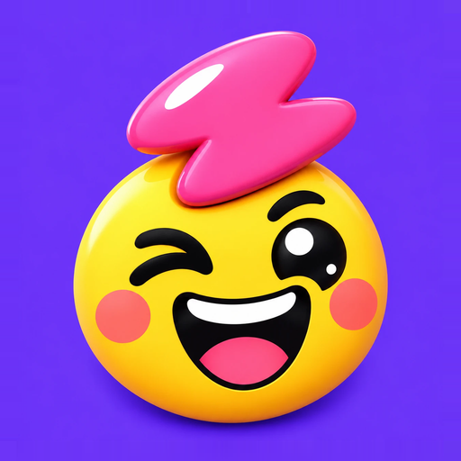

  

<h1 align="center">Chas: Trivia con amigos</h1>

<strong>Tres preguntas al día. Tus amigos, en la misma partida.</strong>

Chas es un juego de trivia diario para jugar con tu grupo: respondes tres preguntas en un minuto, comparas resultados con tus amigos y mantienes la racha. Llegará muy pronto a iPhone y Android.

Este repositorio contiene **solo la web pública** del juego:

- [Inicio](https://[CUENTA].github.io/[REPOSITORIO]/)
- [Política de privacidad](https://[CUENTA].github.io/[REPOSITORIO]/privacidad.html)
- [Condiciones de uso](https://[CUENTA].github.io/[REPOSITORIO]/condiciones.html)

## Contacto
Escríbenos a godiexlabs@gmail.com. Para tus datos personales o para borrar tu cuenta, consulta la [política de privacidad](privacidad.html).

## Derechos
© 2026 [NOMBRE DEL TITULAR]. Todos los derechos reservados. El nombre Chas, la mascota, las ilustraciones y los textos no se pueden reutilizar sin permiso.
